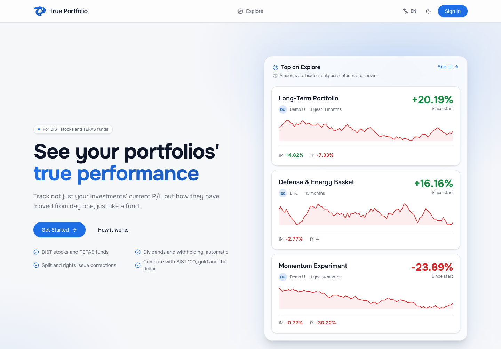
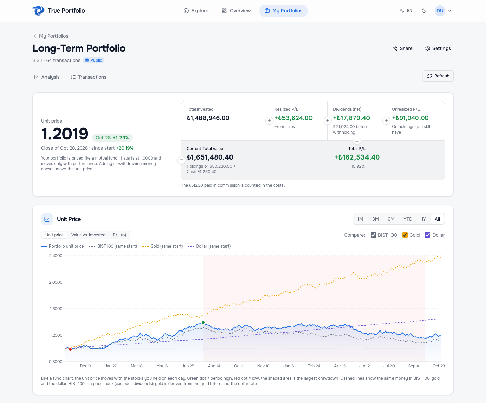
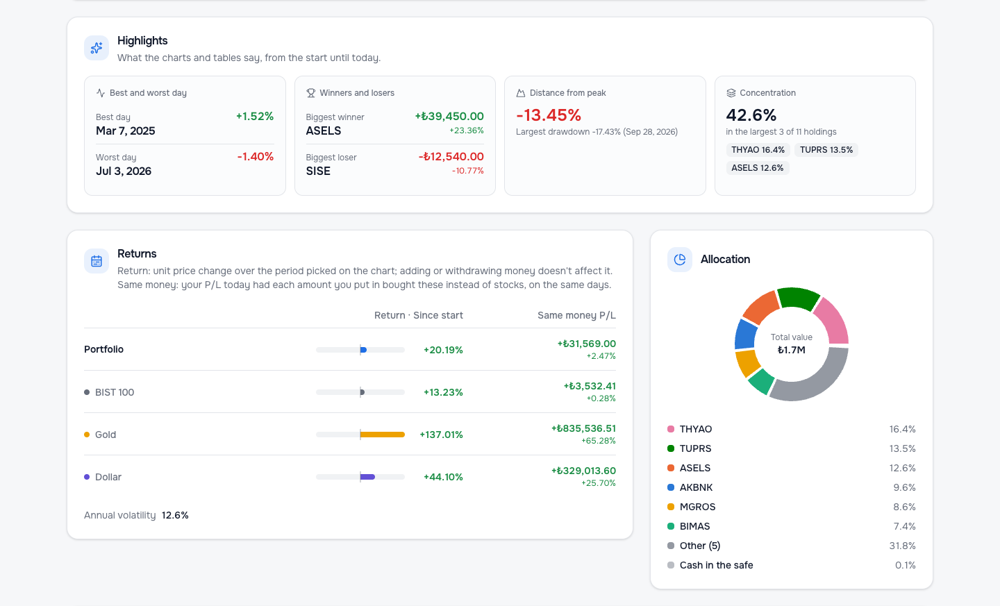
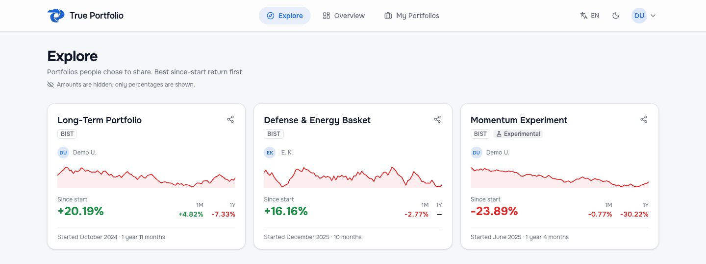

# True Portfolio

**▶ Live: [portfolio.mubatu.com](https://portfolio.mubatu.com)**

See how your Borsa Istanbul (BIST) stock and TEFAS fund portfolios really did over time, not just today's profit and loss.

True Portfolio replays every buy, sell and dividend day by day and prices the portfolio like an investment fund: a unit price that starts at 1.0000 and moves only with performance, so adding or withdrawing money does not distort the picture.

## Portfolio analysis

The unit price next to the money view: what you put in, realized and unrealized P/L, net dividends and where it all adds up today. The chart compares the portfolio with BIST 100, gold and the US dollar started from the same point, and marks the peak, the low and the largest drawdown.

## Highlights, returns and allocation

Best and worst days, biggest winner and loser, distance from the peak and concentration. Returns for any period, and what the same money would have made in BIST 100, gold or dollars.

## Explore

Portfolios people chose to share, ranked by return since start. Only percentages are public: no amounts, quantities or trades.

## Features

- Unit price chart with BIST 100, gold and the US dollar as benchmarks
- Period returns, peak, largest drawdown and recovery, volatility
- Realized and unrealized P/L per stock, net dividends after withholding tax
- Split, bonus issue and rights issue corrections
- TEFAS fund prices from the "Fon Verileri" Excel export
- Overview of all portfolios as one fund
- Turkish and English, light and dark theme, phone layout

## Stack

- **Frontend:** React, TypeScript, Vite, Tailwind CSS, Recharts, TanStack Query
- **Backend:** FastAPI (Python), prices from Yahoo Finance cached in the database
- **Database and auth:** Supabase (Postgres with row-level security)

Screenshots use made-up demo data.
